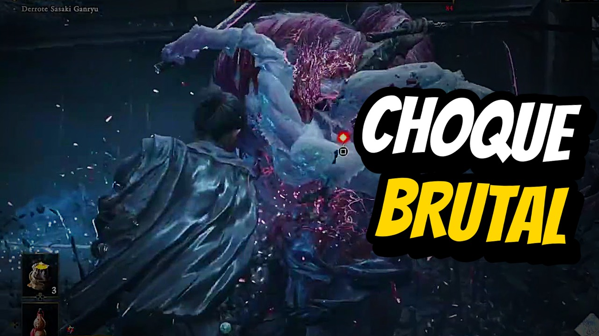
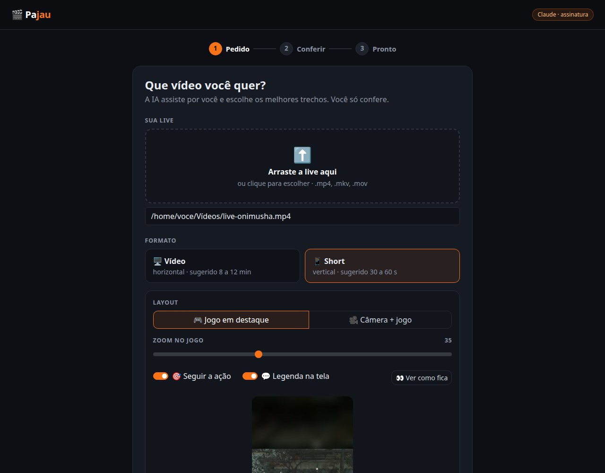
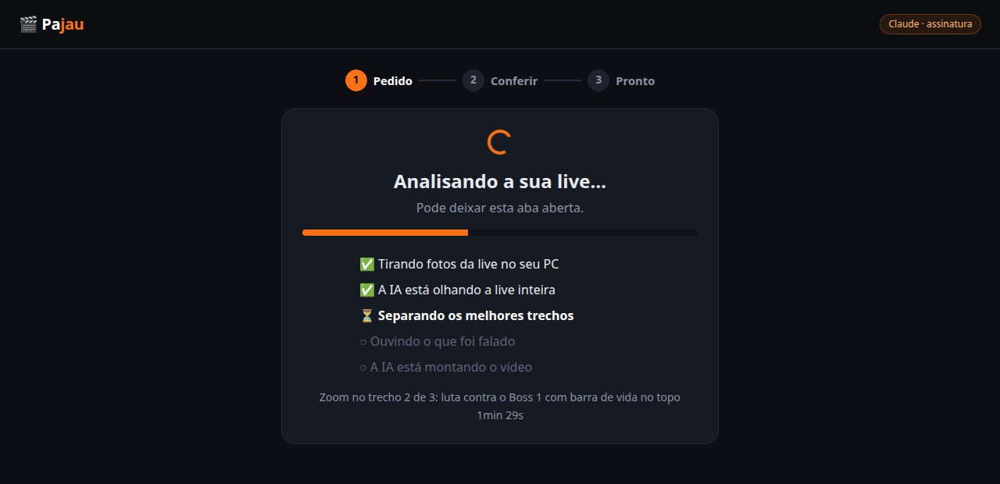
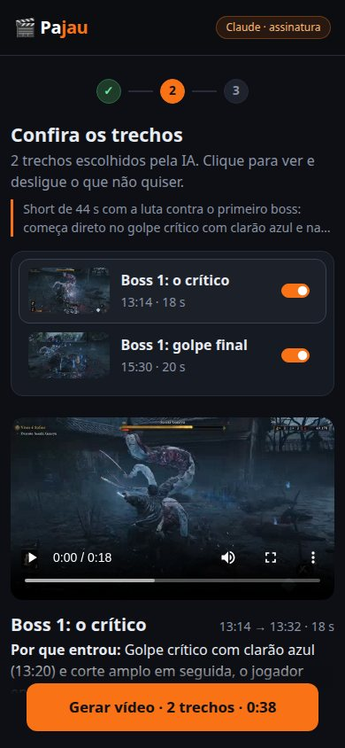

# Pajau

**Transforma uma live longa em um vídeo de melhores momentos.**
Você diz em poucas palavras o que quer ("vitórias contra boss"), a IA escolhe os trechos, você confere e o vídeo sai pronto.

- Roda no seu computador: o vídeo nunca sai da sua máquina.
- Usa a sua assinatura do Claude, sem custo extra. Também funciona com chave de API do Claude ou da OpenAI.
- Faz vídeo horizontal e Short vertical, com legenda, enquadramento e capa automáticos.



## Instalar

Não precisa saber programar: é só copiar e colar os comandos, um de cada vez. Abra o guia do seu computador:

<details>
<summary><b>Windows</b></summary>

O Pajau roda no Windows pelo **WSL**, um Linux que a Microsoft oferece de graça dentro do Windows.

1. Clique no menu Iniciar, digite **PowerShell**, clique com o botão direito e escolha **Executar como administrador**.
2. Cole e aperte Enter:
   ```
   wsl --install
   ```
3. **Reinicie o computador.**
4. No menu Iniciar, abra **Ubuntu**. Na primeira vez ele pede um nome de usuário e uma senha (a senha não aparece enquanto você digita, é normal).
5. Na janela do Ubuntu, siga o guia **Linux** logo abaixo.

Para abrir o Pajau nas próximas vezes: abra o **Ubuntu** e rode `cd editor-video-pajau && make ui`.

</details>

<details>
<summary><b>Mac</b></summary>

1. Aperte <kbd>Cmd</kbd> + <kbd>Espaço</kbd>, digite **Terminal** e aperte Enter.
2. Instale o Homebrew (pode pedir a senha do Mac):
   ```
   /bin/bash -c "$(curl -fsSL https://raw.githubusercontent.com/Homebrew/install/HEAD/install.sh)"
   ```
   No final, ele mostra uns comandos em **Next steps**: copie e rode esses também.
3. Instale o que o Pajau usa:
   ```
   brew install git ffmpeg python
   ```
4. Baixe e instale o Pajau:
   ```
   git clone https://github.com/FabricioPatrocinio/editor-video-pajau.git
   cd editor-video-pajau
   make instalar
   ```

</details>

<details>
<summary><b>Linux</b> (e Windows pelo Ubuntu)</summary>

1. Instale o que o Pajau usa (pede a sua senha):
   ```
   sudo apt update && sudo apt install -y git make ffmpeg python3-venv
   ```
2. Baixe e instale o Pajau:
   ```
   git clone https://github.com/FabricioPatrocinio/editor-video-pajau.git
   cd editor-video-pajau
   make instalar
   ```

</details>

No final ele pergunta qual IA você vai usar. Escolha uma:

| Opção | O que você precisa |
|---|---|
| **1. Assinatura do Claude** (recomendado) | Plano Pro ou Max e o [Claude Code](https://claude.com/claude-code) instalado e logado |
| 2. Claude com créditos | Uma chave em [platform.claude.com](https://platform.claude.com/settings/keys) |
| 3. OpenAI com créditos | Uma chave em [platform.openai.com](https://platform.openai.com/api-keys) |

Mudou de ideia? Rode `make setup` para escolher de novo.

## Usar

```bash
make ui
```

O navegador abre sozinho (se não abrir, acesse http://127.0.0.1:7860). São 3 telas, com um botão principal em cada:

**1. Pedido.** Envie a live (ou cole o caminho), escolha **Vídeo** ou **Short** e diga em poucas palavras o que você quer. No Short, clique em **👀 Ver como fica** para conferir o enquadramento antes de gastar qualquer coisa.



Enquanto a IA trabalha, a tela mostra cada etapa:



**2. Conferir.** Todos os trechos escolhidos já entram. Clique num trecho para ver e desligue o que não quiser.


**3. Pronto.** Baixe o vídeo, copie o título e a descrição e escolha a capa. A IA monta 3 capas; você pode trocar o texto, a fonte, a cor e o lado do texto, e é tudo refeito na hora, sem IA.


A tela também se adapta a janelas pequenas:



## Quanto tempo deve ter o vídeo

A tela já sugere a duração quando você escolhe o formato:

| Formato | Sugestão | Por quê |
|---|---|---|
| Horizontal 16:9 | **8 a 12 min** | Fato oficial: a partir de 8 min o YouTube libera anúncios no meio do vídeo ([ajuda do YouTube](https://support.google.com/youtube/answer/6175006)). |
| Short 9:16 | **30 a 60 s** | Shorts podem ter até 3 min. Não há estudo independente sobre o tamanho ideal: os levantamentos de empresas do setor variam (15–35 s, 30–45 s, 35–58 s), mas concordam que Shorts curtos são vistos até o fim com mais frequência, e isso pesa na recomendação ([resumo 1](https://ytshark.com/ideal-youtube-shorts-length/), [resumo 2](https://www.toptal.com/creator/post/youtube-shorts-length)). |

Vale mais o momento estar completo do que bater o número. Confira a retenção dos seus vídeos no YouTube Studio e ajuste.

## Onde a IA é usada (e quanto gasta)

A IA **nunca assiste ao vídeo**. Ela só recebe fotos pequenas e o texto do que foi falado. Todo o resto roda no seu computador.

| Etapa | Usa IA? | Exemplo real: live de 3h14 |
|---|---|---|
| **1. Mapa da live**: fotos a cada 20 s para achar o que você pediu | Sim | 211 mil tokens de entrada (71% reaproveitados do cache) e 6 mil de saída ≈ **US$ 0,64** |
| **2. Plano**: trechos, ordem, transições, títulos e descrição | Sim | 91 mil de entrada (63% do cache) e 2 mil de saída ≈ **US$ 0,33** |
| **3. Capas**: a IA olha uma imagem com as 12 cenas mais fortes e monta 3 capas | Sim | 11 mil de entrada e 600 de saída ≈ **US$ 0,05** (desligue com `PAJAU_CAPA_IA=false`) |
| Cortes, transições, legenda, Short, volume, trocar texto/cor/fonte da capa, prévias | **Não** | US$ 0 |

**No total:** cerca de **US$ 1 por live** (medido: US$ 0,97 numa live de 3h14 e US$ 0,88 numa de 2h07, com o Claude Opus).

> Esses números foram medidos pela assinatura, antes de uma otimização que tira de cada chamada as instruções internas do Claude Code. Só na capa, isso baixou de 99 mil para 11 mil tokens. Mapa e plano também devem cair; os valores acima serão atualizados com novas medições.

- **Pela assinatura do Claude:** não cobra nada a mais. Esses tokens só contam no limite do seu plano.
- **Pela API:** você paga só o que usar dos créditos. Existe uma trava diária (`PAJAU_AI_DAILY_LIMIT_USD`, padrão US$ 2) que impede novas análises quando o gasto passa disso.

Para gastar menos: reabra análises antigas pela lista **📂 Análises anteriores** (não gasta IA), escolha um modelo mais barato em `ANTHROPIC_MODEL` ou aumente `PAJAU_MAPA_SEGUNDOS` (menos fotos no mapa).

## Deu problema?

- **"claude: command not found"**: instale o Claude Code com `curl -fsSL https://claude.ai/install.sh | bash`, feche e abra o terminal, rode `claude` uma vez para fazer login e depois `make setup`.
- **"ffmpeg not found"**: volte ao passo 1.
- **Outra coisa**: abra uma [issue](../../issues) contando o que apareceu na tela.

Configurações avançadas ficam no arquivo `.env`, com a explicação de cada uma em [`.env.example`](.env.example).

## Apoie

O Pajau é livre e gratuito. Se ele te poupou horas de edição, considere um Pix:

**Chave Pix:** `fabricioschiffer@gmail.com`

## Contribuir

Ideias e correções são bem-vindas: abra uma [issue](../../issues) ou um pull request.

Licença [MIT](LICENSE).
