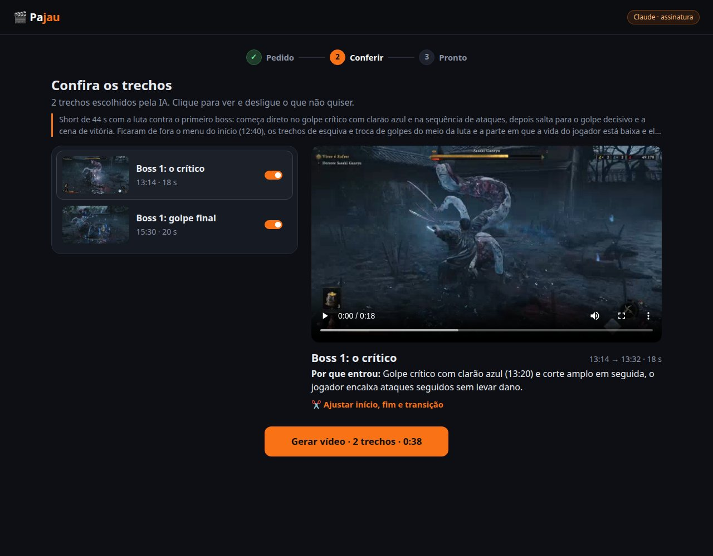
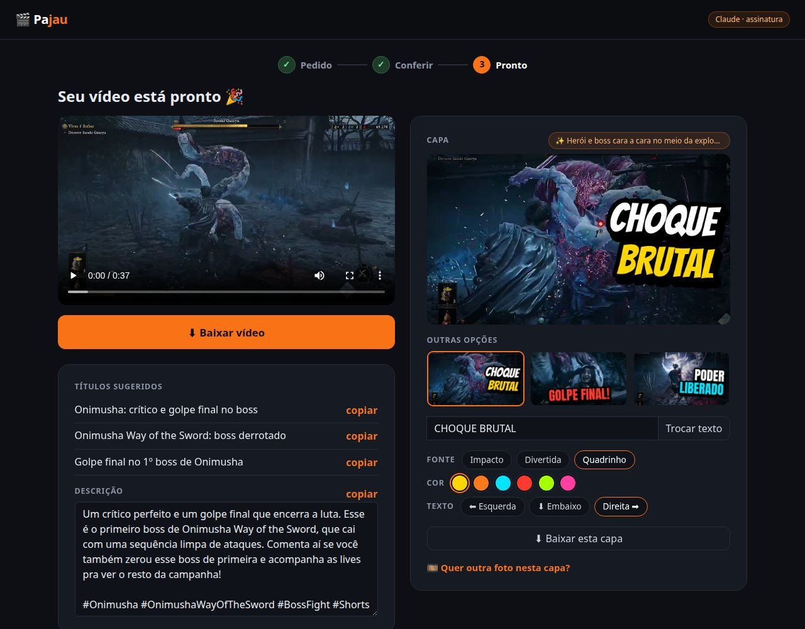

# Pajau

**Transforma uma live longa em vídeo de melhores momentos ou Short, com legenda e capa.**
Você diz o que quer em poucas palavras, a IA escolhe os trechos, você confere e baixa.

- Roda no seu computador: a live nunca sai da sua máquina.
- Usa a sua assinatura do Claude (sem custo extra) ou chave de API do Claude ou da OpenAI.

## Instalar

Não precisa saber programar: é só copiar e colar os comandos, um de cada vez. Abra o guia do seu computador:

<details>
<summary><b>Windows</b></summary>

O Pajau roda no Windows pelo **WSL**, um Linux que a Microsoft oferece de graça dentro do Windows.

1. Clique no menu Iniciar, digite **PowerShell**, clique com o botão direito e escolha **Executar como administrador**.
2. Cole e aperte Enter:
   ```
   wsl --install
   ```
3. **Reinicie o computador.**
4. No menu Iniciar, abra **Ubuntu**. Na primeira vez ele pede um nome de usuário e uma senha (a senha não aparece enquanto você digita, é normal).
5. Na janela do Ubuntu, siga o guia **Linux** logo abaixo.

Para abrir o Pajau nas próximas vezes: abra o **Ubuntu** e rode `cd editor-video-pajau && make ui`.

</details>

<details>
<summary><b>Mac</b></summary>

1. Aperte <kbd>Cmd</kbd> + <kbd>Espaço</kbd>, digite **Terminal** e aperte Enter.
2. Instale o Homebrew (pode pedir a senha do Mac):
   ```
   /bin/bash -c "$(curl -fsSL https://raw.githubusercontent.com/Homebrew/install/HEAD/install.sh)"
   ```
   No final, ele mostra uns comandos em **Next steps**: copie e rode esses também.
3. Instale o que o Pajau usa:
   ```
   brew install git ffmpeg python
   ```
4. Baixe e instale o Pajau:
   ```
   git clone https://github.com/FabricioPatrocinio/editor-video-pajau.git
   cd editor-video-pajau
   make instalar
   ```

</details>

<details>
<summary><b>Linux</b> (e Windows pelo Ubuntu)</summary>

1. Instale o que o Pajau usa (pede a sua senha):
   ```
   sudo apt update && sudo apt install -y git make ffmpeg python3-venv
   ```
2. Baixe e instale o Pajau:
   ```
   git clone https://github.com/FabricioPatrocinio/editor-video-pajau.git
   cd editor-video-pajau
   make instalar
   ```

</details>

No final ele pergunta qual IA você vai usar. Escolha uma:

| Opção | O que você precisa |
|---|---|
| **1. Assinatura do Claude** (recomendado) | Plano Pro ou Max e o [Claude Code](https://claude.com/claude-code) instalado e logado |
| 2. Claude com créditos | Uma chave em [platform.claude.com](https://platform.claude.com/settings/keys) |
| 3. OpenAI com créditos | Uma chave em [platform.openai.com](https://platform.openai.com/api-keys) |

Mudou de ideia? Rode `make setup` para escolher de novo.

## Usar

```bash
make ui
```

O navegador abre sozinho (ou acesse http://127.0.0.1:7860).

**1. Pedido** · envie a live, escolha Vídeo ou Short e diga o que quer.


**2. Conferir** · desligue o que não quiser.



**3. Pronto** · baixe o vídeo, copie título e descrição e escolha a capa.



Quer outro vídeo da mesma live? Em **📂 Suas lives**, clique em **➕ Novo vídeo desta live**: a IA reaproveita o que já viu e sai bem mais barato.

## Duração sugerida

| Formato | Sugestão | Por quê |
|---|---|---|
| Vídeo 16:9 | 8 a 12 min | Com 8 min ou mais, o YouTube libera anúncios no meio ([fonte](https://support.google.com/youtube/answer/6175006)) |
| Short 9:16 | 30 a 60 s | Shorts curtos são vistos até o fim com mais frequência (sem estudo oficial; [levantamento](https://ytshark.com/ideal-youtube-shorts-length/)) |

## Quanto gasta de IA

A IA nunca assiste ao vídeo: recebe só fotos pequenas e o texto falado. Cortes, legenda, Short e capas são feitos no seu PC.

| Etapa | Live de 3h14 (medido) |
|---|---|
| Mapa da live (a IA acha o que você pediu) | ≈ US$ 0,64 |
| Plano (trechos, títulos e descrição) | ≈ US$ 0,33 |
| Capas (a IA escolhe cena, texto e cor) | ≈ US$ 0,05 |
| Novo vídeo da mesma live | o mapa vira uma consulta curta em texto; o resto igual |

- **Assinatura do Claude:** sem custo extra, só usa o limite do plano.
- **API:** cerca de US$ 1 por live, com trava diária em `PAJAU_AI_DAILY_LIMIT_USD` (padrão US$ 2).

Valores medidos antes de uma otimização recente; a tendência é ficarem menores.

## Deu problema?

- **"claude: command not found"**: instale o Claude Code com `curl -fsSL https://claude.ai/install.sh | bash`, feche e abra o terminal, rode `claude` uma vez para fazer login e depois `make setup`.
- **"ffmpeg not found"**: volte ao passo 1.
- **Outra coisa**: abra uma [issue](../../issues) contando o que apareceu na tela.

Configurações avançadas ficam no arquivo `.env`, com a explicação de cada uma em [`.env.example`](.env.example).

## Apoie

O Pajau é livre e gratuito. Se ele te poupou horas de edição, considere um Pix:

**Chave Pix:** `fabricioschiffer@gmail.com`

## Contribuir

Ideias e correções são bem-vindas: abra uma [issue](../../issues) ou um pull request.

Licença [MIT](LICENSE).
